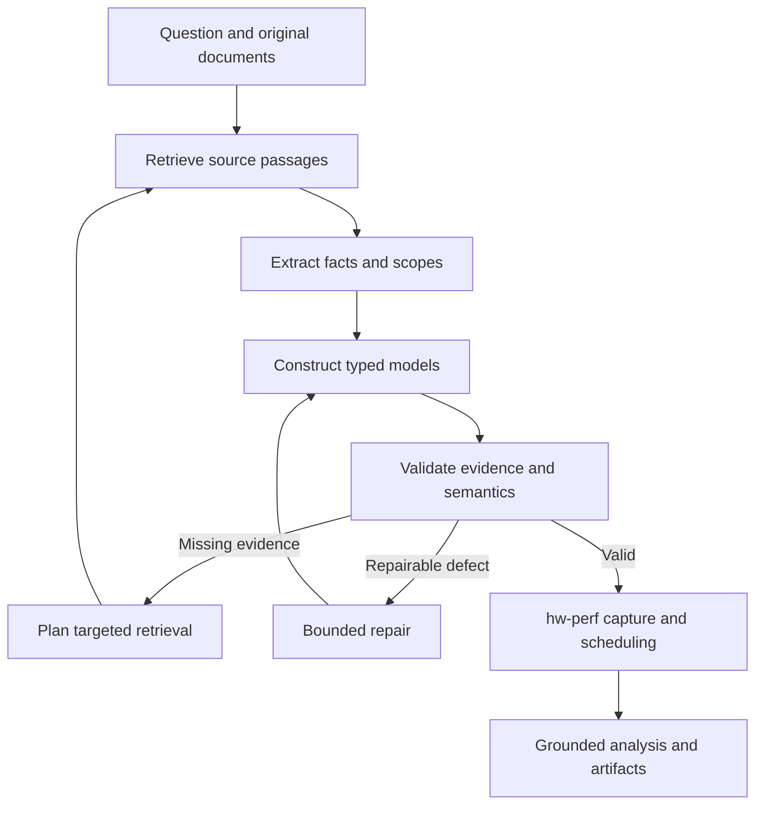

# Paper2Perf

Ask questions about original hardware documents, construct evidence-linked hardware/workload
models, and run performance investigations using LangGraph and **bundled hw-perf source**.
There are no Git submodules or private-repository downloads required to install the application.

## Status

This is a new implementation built from the supplied `hw-perf(3).zip`, not the previous
Paper2Perf prototype. It contains document ingestion/retrieval, cited chat, a LangGraph
investigation graph, typed hardware/GEMM models, validation and repair, a source-specific
hw-perf adapter, persistent conversation/run artifacts, and a terminal chat interface.

**Validation status:** the project virtualenv includes LangGraph, PyTorch 2.10.0+cpu, and the
bundled hw-perf runtime. The full unit suite and the `scripts/verify_a100.py` real-backend
check pass. No general accuracy or reliability claim is made; semantic source interpretation
still needs independent review.

## Install and run

Use Python 3.12 or newer (this checkout is verified on Python 3.14). A GPU is not required:
PyTorch describes and symbolically captures the workload; the mapper calculates a modeled
schedule. The upstream source uses PyTorch internal symbolic
shape APIs; this project pins PyTorch **2.10.0** (including its `+cpu` build).
The adapter temporarily bridges the `ShapeEnv` backed-symbol API names used by the
bundled Parabolic snapshot to PyTorch 2.10's `var_to_val` / `add_var_to_val` names.
It restores the class after execution and records the compatibility mode in metrics.
The original upstream files and their recorded source hashes remain unchanged.

```bash
python3 -m venv .venv
source .venv/bin/activate
python -m pip install --upgrade pip
python -m pip install 'torch==2.10.0' --index-url https://download.pytorch.org/whl/cpu
python -m pip install -e '.[dev]'

cp .env.example .env
# Edit .env and set PAPER2PERF_MODEL and PAPER2PERF_API_KEY.
# All documented settings, budgets, and retry controls live in that file.
# Shell exports still take precedence over .env values.

paper2perf doctor
paper2perf chat --documents /path/to/a100-whitepaper.pdf
```

The interactive prompt runs directly in the terminal. Add original PDF/TXT/Markdown documents,
then ask a question or request an experiment. Model calls send selected document excerpts
and recent conversation context to your configured provider. Credentials are read from `.env` in
the current working directory (or from shell exports, which win). Set `PAPER2PERF_ENV_FILE` to load
a different file. The endpoint must support JSON-object responses and `max_completion_tokens`.

The command above installs the CPU-only PyTorch wheel. Omit the `--index-url` line if you want
the default PyPI build instead.

## A100 document-to-simulation workflow

Version 0.2 constructs hardware with a **reference-only blueprint**. The design model selects
source fact IDs, source resource/relationship IDs, and the requested GEMM. Trusted code computes
all hardware numbers, independently rechecks the arithmetic, validates the topology and precision,
and submits the resulting graph to bundled hw-perf. There is no built-in A100 specification table.

The design contract separates typed source/workload blockers from modeling limitations. The compiler
computes missing numeric inputs from actual references. Legacy free-form `missing` entries trigger
a bounded **design repair**, not another document retrieval. Repair must preserve genuine source
uncertainty as a typed blocker and reclassify unmodeled details as limitations. Register-file timing,
fixed access latency and a document-provided tiling/wave schedule are not required inputs. Combined
L1/SMEM pooling uses combined capacity, not the maximum configurable SMEM allocation.
`design-validation.json` and `model-gaps.json` record the distinction.

A redundant binding from an already-modeled compute node to its local memory is removed only
when its selected-variant containment proof and the matching access edge are present. The compute
node, access link and all quantities are preserved, and the removal is recorded in topology-audit.json.
Absent/forged proofs or missing access edges still stop construction; strict bandwidth requirements
and independent final-IR binding validation are unchanged.

Resource IDs are checked against source relationships before constructing hardware. If an
unmodeled grouping container has exactly one documented contained modeled memory boundary, the
compiler can project the container's connections onto that boundary. It keeps the distinct compute
node, records the containment proof, and restores omitted source `connects` relationships. Recovered
links still require documented bandwidth or the explicitly selected proxy policy. Ambiguous mappings,
conflicting rates, and unproved renames are rejected. Projected duplicate edges retain all relationship
IDs without multiplying bandwidth. `topology-audit.json` records each binding, projection, and recovery;
this boundary projection is an aggregate-model abstraction, not a measured physical topology.

PDF ingestion preserves raised numeric glyphs as superscripts when glyph geometry and the text
word stream agree; baseline numbers are unchanged. For example, a value followed by a raised
footnote is not concatenated into a larger number. Ambiguous alignment falls back to separated
spans. Existing document indexes are not silently rewritten: start a new chat with the original
PDF to use the updated extraction while keeping historical run evidence reproducible.
A `source_conflict` design blocker must identify at least two incompatible verified facts using
`conflicting_fact_ids`. Comparisons across variants, precision, aggregation, or units return to
design repair for an explicit scope decision. True unresolved source scope and same-scope
contradictions still block simulation; they are never automatically discarded.

A resource that is already a combined memory block needs no alias pool. A reflexive sharing
annotation is accepted only with the selected combined-capacity fact and a single-memory-block
source proof. It is recorded in `topology-audit.json` as an already-combined memory, not a bandwidth
edge or a second capacity. Ordinary self-transfers and ambiguous representations remain errors;
actual physical alias pools still require at least two distinct logical members.

Shared physical memory is represented explicitly: `shares_resource` records logical views of a
single block. A memory pool requires an exact single-memory-block source passage and the selected
combined-capacity fact; it counts that capacity once and retains logical resource identities in the
topology audit. Similar names, different cache levels, and separate physical memories are never
merged without this proof. Missing standalone-view bandwidth does not create a fictitious channel
inside a shared pool. A maximum configurable SMEM allocation cannot replace combined capacity.

Retrieval follows bounded table-of-contents page references into the original document body. It
prioritizes capacity and cache/compute access passages, retains cited context, and passes compiler
requirements plus the previous verified extraction back into extraction. Missing numeric capacities
and disconnected source topology are reported together and trigger targeted retrieval, rather than
repeated attempts to repair the same unmodeled node. No missing capacity or connection is fabricated.
Memory-to-memory paths must use only memory intermediates, matching the bundled backend.
A graph connected only through a compute node is rejected and its missing memory path is retrieved.
The attached failed-run regression replays all three captured designs and checks their actual gaps;
a scripted source-repair oracle tests the model boundaries and a dependency-gated real backend test
checks the resulting graph. Those tests do not claim a fresh live-model success or physical accuracy.

Supported deterministic derivations are SI/binary unit conversion, explicitly per-SM capacity
times the selected product's SM count, and device bytes/clock times a cited device GPU clock.
Mixed variants and unsupported operations are rejected. Boost-clock conversion is a peak-rate
scenario, not a claim about sustained clocks. Per-SM capacities are pooled in this aggregate
model; the model does not simulate SM ownership, cache hits, or occupancy independently.

The default `hbm-proxy` policy uses the selected device's documented HBM bandwidth as an
**assumed** rate for unresolved internal links. This policy does not assert that the links
actually have that rate, nor that the result is a lower or upper bound. Every proxy is recorded
in `assumptions.json`, `derivations.json`, and the result report; it is a recorded modeling
policy, not a hidden fallback. Use `--bandwidth-policy strict` to stop on missing required rates.
Specific measured values can instead be supplied with `--assumptions`; the blueprint must reference
their exact assumption IDs. In chat, `/bandwidth-policy strict|hbm-proxy` switches the current
chat; new chats default to `hbm-proxy`.

A fresh run from the original whitepaper uses the model for extraction and blueprint selection:

```bash
paper2perf run --documents /path/to/nvidia-ampere-architecture-whitepaper.pdf \
  --mode simulate --bandwidth-policy hbm-proxy --no-llm-analysis \
  --question "Simulate C = A × B on the documented A100. A and B are both 256 × 256. Use dense FP16, no bias. Preserve the documented memory hierarchy."
```

To reuse the already extracted evidence from the uploaded investigation, run this from your
existing project directory after updating the source and reinstalling the editable package:

```bash
python -m pip install -e . --no-deps
paper2perf replay 168c11ef3b214d7fa172ce00b8627e87 \
  --gemm 256 256 256 --dtype fp16 \
  --blueprint examples/a100-whitepaper-blueprint.json \
  --bandwidth-policy hbm-proxy
```

`--gemm` is **M N K**, with A=(M,K), B=(K,N). Replay creates a new LangGraph investigation in the
same session, revalidates saved fact values and quotes against the original catalog chunks, then
constructs, validates, captures, maps, schedules, and reports. It does not resume the old terminal
run. With a supplied blueprint, replay needs **no API key or model calls**. Without a blueprint,
it reuses `blueprint.json` from the source run when available, otherwise calls the design model
once. Replay always uses deterministic interpretation of actual backend metrics.

The included A100 blueprint contains **fact/relationship references, not hardware numbers**.
It is an explicit construction plan for the supplied extraction's identifiers, not a production
fallback for another document. The normal agent generates a new blueprint for a fresh extraction.
The cited whitepaper, local sessions and run database are not bundled into the source release;
keep your existing `data/` directory to replay your investigation.

To see strict missing-input reporting, repeat the replay command without `--bandwidth-policy`.
To run another shape from a new completed run, pass its ID to `replay --gemm M N K`; its saved
blueprint is reused and hardware assumptions are regenerated only if explicitly opted into again.

Review the new run with:

```bash
paper2perf inspect NEW_RUN_ID --artifact derivations.json
paper2perf inspect NEW_RUN_ID --artifact assumptions.json
paper2perf inspect NEW_RUN_ID --artifact metrics.json
```

A completed simulation exports `hardware-graph.json`, `mapping-graph.json`, `scopes.json`,
`events.json`, and one standalone Plotly Gantt chart per tiling scope
(`gantt-<scope>.html`). Its makespan comes from the actual bundled mapper, never from the model
or a roofline fallback. Check `Status: completed` and the backend artifacts before recording a demo.
An unavailable backend is reported as blocked and does not produce a fabricated result.

## CLI commands

| Command | Purpose |
|---|---|
| `paper2perf chat --documents source.pdf` | Interactive document questions and experiments |
| `paper2perf chat --session SESSION_ID` | Continue a saved conversation |
| `paper2perf run --documents source.pdf --question "..."` | Run one question or experiment synchronously |
| `paper2perf inspect RUN_ID` | Read saved results and list artifacts without a model call |
| `paper2perf inspect RUN_ID --artifact evidence.json` | Print one artifact |
| `paper2perf replay RUN_ID --gemm M N K` | New experiment using revalidated evidence and optional saved blueprint |
| `paper2perf resume RUN_ID` | Resume a failed/interrupted LangGraph checkpoint |
| `paper2perf sessions` | List saved conversations |
| `paper2perf doctor` | Check model and dependency configuration |

`chat` and `run` default to `--mode auto`, `--bandwidth-policy hbm-proxy`, and deterministic
analysis. Pass `--mode question|simulate|inspect` to override regex routing,
`--bandwidth-policy strict` for evidence-only behavior, or `--llm-analysis` to let the model
interpret simulation metrics.

Set `PAPER2PERF_DATA_DIR` to choose the local state directory, or place `--data-dir PATH`
before the command. `run`, `inspect`, `resume`, and `sessions` support `--json` for machine-readable
stdout. Investigation progress goes to stderr; `--quiet` suppresses progress for `run`, `chat`,
and `resume`. By default, low-level evidence stages (`route`, `retrieve`, `extract`,
`extraction_validation`, `repair_extraction`, `plan_retrieval`) and the long `Scenario`,
`Model scope`, `Limitation`, `Explicit modeling assumptions`, and `Simulator conventions`
report sections are hidden. `--verbose` shows them; `--json` always contains the complete
saved result. A one-shot run exits 0 on completion, 1 for a failed/blocked/incomplete run,
2 for an invalid command input or local file error, and 130 for interruption.
JSON output includes session/run IDs.

```bash
paper2perf run \
  --documents /path/to/a100-whitepaper.pdf \
  --mode simulate \
  --question "Simulate a 256 by 256 by 256 dense FP16 GEMM on the documented GPU." \
  --json
```

In chat, type `/help` for commands:

- `/add /path/to/another-source.pdf` adds original evidence.
- `/documents` lists this conversation's sources.
- `/mode question` answers document questions; `/mode simulate` runs experiments;
  `/mode inspect` answers questions about the latest completed simulation; `/mode auto` detects
  question/simulate/inspect requests with deterministic regex matching. Explicit modes override it.
- `/assume ID VALUE UNIT RATIONALE` records one explicit modeling assumption. Units are
  `byte`, `byte/s`, or `FLOP/s`. `/assumptions` shows values and `/clear-assumptions` removes them
  from subsequent requests. Chat assumptions and explicit clearing persist across chat sessions.
- `/runs`, `/inspect RUN_ID`, and `/resume RUN_ID` inspect or resume this conversation's runs.
- `/quit` or Ctrl-D exits; the conversation stays saved.

For batch experiments, `--assumptions assumptions.json` accepts a JSON array of objects with
`id`, positive numeric `value`, `unit`, and `rationale`. Values must be explicitly justified;
the framework does not invent missing parameters. Batch runs do not inherit old assumptions.
An explicit `--documents` list selects those sources for that run; otherwise `--session` reuses
all documents in the conversation. Terminal chat uses all of its conversation's sources.

## Try a document-driven conversation

1. Start `paper2perf chat --documents /path/to/a100-whitepaper.pdf` with the original document.
2. Ask: **"What dense FP16 throughput and memory bandwidth are documented? Cite the pages."**
3. Ask: **"Simulate a 256 by 256 by 256 dense FP16 GEMM on the documented device."**
4. Read the stage progress and inspect the printed artifact directory or use `paper2perf inspect`.
5. Ask: **"Which assumptions were used in the latest experiment?"**

If a required parameter is absent, the agent performs targeted searches within the supplied
documents and then reports missing evidence. Add another original source with `/add` or record
a specific justified assumption with `/assume`. There is no silent A100 default, reference-model
substitution, internet retrieval, or LLM latency fallback. Citations print exact source excerpts,
page numbers, and paths to preserved originals; source pages can be checked in your own PDF reader.

The default scope is a **single-device aggregate hardware graph and dense bias-free GEMM** in
FP16/FP32. Device variants, precision, dense/sparse mode, and aggregation scope are explicit.
Unsupported operations or missing dimensions should produce a limitation instead of a fake run.

## Architecture

The entry graph routes document questions, simulation requests, and existing-result questions.
In `auto` mode, regex matching selects the route; explicit `--mode` or `/mode` overrides it.
The investigation path is:



Document questions use retrieval and cited answers without simulation. Result questions inspect
the latest completed simulation's artifacts. LangGraph checkpoints each run in SQLite, and
failed/interrupted runs can resume with `paper2perf resume RUN_ID`. A new message starts a new
run in the same persistent conversation. Investigations execute synchronously; an OS-managed
lock allows one active investigation per data directory, including across CLI processes.
Document and result answers receive up to two bounded repair attempts when quotation or
numeric checks fail. Rejected claims and cited numbers are saved in `answer-validation.json`
(or `inspect-answer-validation.json`) and per-attempt records. Exhaustion produces a limitation,
not an accepted unsupported answer. Arrow-key editing/history uses Python's optional readline
module; terminal history is not written to a separate history file.
Evidence extraction also has up to two bounded repair attempts for malformed contracts,
unsupported fact values, or invalid quotations/chunk IDs. `extraction-validation.json` and
per-attempt records retain the diagnostics; `evidence.json` is written only after verification.
Exhausted extraction retries stop before model construction and simulation. Rejected references
are never silently replaced: the agent must revise them and pass the same source checks.

| Code | Responsibility |
|---|---|
| `cli.py`, `runner.py` | Terminal chat, foreground execution, inspection, and resume |
| `documents.py`, `store.py` | Original-file preservation, page/chunk indexing, scoped FTS retrieval |
| `schemas.py`, `evidence.py` | Typed contracts, exact quotations, unit/variant/precision/assumption checks |
| `compiler.py`, `calculations.py` | Reference-only blueprint compilation and independently checked dimensional arithmetic |
| `graph.py`, `state.py`, `nodes.py` | LangGraph routing, state, evidence search, repair, simulation, reporting |
| `llm.py`, `prompts/` | Configurable model calls and editable task instructions |
| `workload.py` | Trusted GEMM materialization and numerical probe |
| `hwperf.py`, `hwperf_worker.py` | Source verification and the sole performance backend |
| `vendor/hw-perf/` | Unmodified upstream runtime packages, copied as ordinary tracked files |
| `scripts/evaluate.py`, `tests/` | Document-driven evaluation runner and automated checks |

### Actual simulator integration

The adapter constructs `hw_model.HardwareGraph` directly from the validated typed hardware IR.
It uses `parabolic.dataflow.frontend.pytorch.create_parabolic_parallel_model` to capture a
trusted `torch.mm` module, then `apply_tiling_plan` and
`dataflow_mapper.execution.map_with_capacity_retiling` to place, route, and schedule it.
`MappingResult.latency` supplies the predicted makespan. `MappingTrace` supplies scope/event
artifacts. These API names/signatures were inspected in the supplied source archive.

This bypasses SPROOF YAML parsing; it does not require SPROOF's separate checkout or execute
model-authored Python. Hardware IR and the concrete NetworkX graph are exported as JSON.
Only the mapper, `hw_model`, and Parabolic runtime packages are needed, so unrelated vendored
simulators, huge example outputs, and upstream internal plans are not copied.

Modeling conventions are explicit in every simulation result: aggregate single-device graph,
undirected links, zero fixed transfer overhead, and standard MAC/ALU FLOP accounting. K tiling
is used only if the evidence-backed model includes vector capability for its reduction.

### Evidence boundaries

Every numeric hardware quantity references extracted facts and a whitelisted derivation,
or an explicit user-supplied/policy-authorized assumption. The validator rejects unsupported
conversions or arithmetic, mixed variants, precision mismatches, and sparse rates for dense matrix compute.
Original facts retain source values/units and exact quotations with page references.

These are mechanical checks, **not proof that an excerpt entails every interpretation**.
Table extraction, variant interpretation, topology interpretation, and explanatory claims still
need independent evaluation. Scanned PDFs require OCR before ingestion. Text retrieval is lexical;
there is no visual-table or image reasoning in this version. Grounding validation checks
quotation existence and numeric consistency; it does not prove causal explanations.

Default budgets per run: 12 model calls, 3 retrieval rounds, 2 model repairs, and 120 seconds
for simulation. A failed backend is reported as blocked; a missing model is reported as
needing information. Neither counts as a completed simulation.

### Provider errors, pacing, and output limits

Temporary HTTP 429/408/409/5xx and transport failures receive up to three bounded HTTP retries.
Retries honor `Retry-After` (including HTTP dates) or `retry-after-ms` and otherwise use exponential
backoff with jitter. A server delay above the automatic wait limit stops with instructions to
wait and resume; it is never shortened. Quota/billing/spend-limit errors stop without retrying.
`model-error.json` and per-request error records retain redacted provider error codes/messages,
request IDs, and selected rate-limit headers. Credentials and authorization headers are excluded.
Each HTTP attempt counts toward the run's total model-call budget, including across resume.

Optional environment settings:

| Variable | Default | Purpose |
|---|---|---|
| `PAPER2PERF_HTTP_RETRIES` | `3` | Additional HTTP attempts per request, at most 5 |
| `PAPER2PERF_RETRY_BASE_SECONDS` | `2` | Initial exponential backoff |
| `PAPER2PERF_RETRY_MAX_WAIT_SECONDS` | `60` | Maximum automatic retry wait |
| `PAPER2PERF_MODEL_MIN_INTERVAL_SECONDS` | `0` | Minimum spacing between request starts |
| `PAPER2PERF_MAX_MODEL_CALLS` | `12` | Total HTTP request budget; increasing explicitly allows more calls |
| `PAPER2PERF_MAX_COMPLETION_TOKENS` | `6000` | Provider completion-token cap |
| `PAPER2PERF_REASONING_EFFORT` | unset | Optional supported model reasoning setting |

Response records include `finish_reason` and full usage metadata. Empty assistant content and
`finish_reason=length` stop with diagnostics instead of being treated as ordinary extraction
JSON mistakes and repeatedly sent with the same token limit. Inspect usage before changing
the completion cap or reasoning setting; reasoning tokens can consume the completion budget.
Raising the cap may increase token requirements and worsen throttling. No automatic cap increase
or model change is performed. `paper2perf` loads `.env` from the current working directory when
`Settings.from_env()` runs; existing shell variables are never overridden. `paper2perf doctor`
reports which env file was loaded (or `null`).

For the canonical OpenRouter endpoint (`https://openrouter.ai/api/v1`),
`PAPER2PERF_REASONING_EFFORT=none` sends `reasoning: {"enabled": false}`; other explicit efforts
send `reasoning: {"effort": "..."}`. Direct OpenAI-compatible endpoints retain the top-level
`reasoning_effort` field. Use only controls supported by the selected model; models requiring
reasoning cannot disable it. Leaving the setting unset preserves the provider's default and
does not request reasoning off. The output-limit diagnostic reports provider reasoning-token
usage when available and the size of visible assistant content. These help distinguish exhausted
reasoning budgets from oversized JSON; absent usage metadata does not establish either cause.

## Artifacts and reproducibility

By default, local state is under `data/` (override with `PAPER2PERF_DATA_DIR`). It includes
original documents, SQLite conversation/checkpoint databases, and `runs/<id>/` containing:

- Recorded model requests/responses and source document hashes.
- `evidence.json`, `blueprint.json`, `derivations.json`, `assumptions.json`, `model-gaps.json`.
- `proposal.json`, `hardware.json`, `workload.json`, `workload.py`.
- `evidence-reuse.json` for replay, recording the source run and evidence hash.
- `retrieval-*.json` and `topology-audit.json` for source navigation, physical pools and projections.
- Validation diagnostics and generated-model revisions.
- Real-backend request/response, mapping graph, scopes, events, and numerical validation.
- `gantt-<scope>.html`: one self-contained Plotly Gantt chart per tiling scope, with the
  absolute schedule timeline and hardware-resource lanes. Each file embeds Plotly's JavaScript,
  so it opens without a network connection or a separate report bundle.
- `metrics.json`, `analysis.json`, `report.md`, and `manifest.json`.

Source provenance identifies the uploaded archive by SHA-256. No upstream Git commit is claimed
because the archive contains no Git metadata. Runtime Python files are verified against their
original hashes. See `vendor/hw-perf/SOURCE_MANIFEST.json` and `THIRD_PARTY_NOTICES.md`.

## Test

```bash
python -m unittest discover -s tests -v
# Non-skipping regression check: invokes the real backend, requires its dependencies.
python scripts/verify_a100.py
```

The graph tests use scripted model responses **only inside tests**. The simulator smoke test
calls the real bundled backend. It must run successfully on an installed environment; a skipped
integration test is not evidence of working simulation. Replay reuses checked source extraction, never an old predicted makespan. A new shape/model is submitted to the real backend.

## Evaluate on original documents

Create a JSON array of cases with `id`, `documents` (paths relative to the JSON file), `question`,
optional `mode` and explicit `assumptions`, and optional `expected_facts`. Each annotated fact
has `parameter`, `value`, `unit`, and `variant`. Construct annotations independently from the
source documents. They are used only by the evaluator and never sent to the agent.
Use the extraction prompt's canonical parameter names: `memory_capacity`, `memory_bandwidth`,
`cache_capacity`, `cache_bandwidth`, and `compute_throughput`.

```bash
python scripts/evaluate.py /path/to/cases.json --condition one-shot --output runs/one-shot.json
python scripts/evaluate.py /path/to/cases.json --condition agentic --output runs/agentic.json
```

The one-shot condition disables additional retrieval and repair, retaining the same pipeline.
The runner reports completion, elapsed time, and exact annotated-fact recall. Compare multiple
independent trials using the same documents/model/settings. Independently review source entailment,
unsupported assumptions, and failure categories. Prediction accuracy requires physical measurements
or another justified ground truth; agreement with a reference model alone does not establish it.

Automatic parameter sensitivity studies, arbitrary workload generation, visual/OCR document
understanding, and multi-device modeling are not implemented. The next experiment must currently
be requested explicitly by the user. No empirical reliability or accuracy claim is made yet.

Internal planning documents, `docs/`, agent instructions, local runs, uploads, credentials, and
environments are excluded from Git. The runnable README, source, prompts, tests, and upstream
source snapshot belong in the repository.
